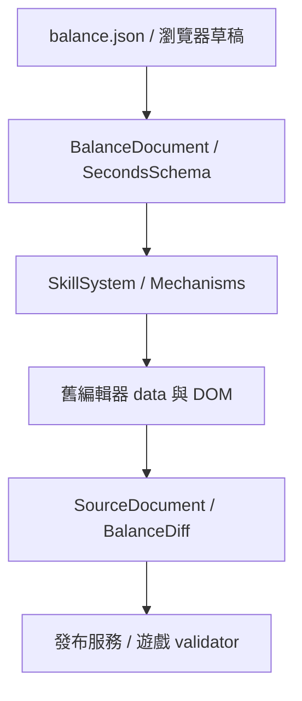

# Dreaming Abyss V2 開發者模式第一階段稽核

遊戲基準：`cea79fe8920b78d20cd26db717628039e9c1b500`。由 `node scripts/audit-v2.cjs` 重建；輸出不含時間戳，來源不變時可重現。

- 欄位清冊是目前文件所有觀測路徑，並非完整 schema。
- observedOptional 只表示同類物件有缺值，不能當作 schema 選用欄位定義。
- 靜態引用、依賴和 DOM 清冊是候選證據；未解析所有別名、字串路徑及作用域，不等於編輯支援或完整呼叫圖。
- optionalFields 是有來源行號的秒數 schema 補充清單，不宣稱涵蓋所有選用或動態欄位。
- 不計算未經逐欄操作驗證的 UI 覆蓋率。
- roundTrip 保留 raw JSON 的完整差異，包含 _reference 與 notes。
- 未修改資料、預設、規則或遊戲數值。

## 清冊摘要

- fieldPaths：1909
- canonicalTimeOrResource：59
- observedOptional：142
- withStaticEditorReference：174
- modules：90
- sections：47
- domReferences：1044
- unverifiedEditing：1909

完整逐欄路徑、型別、缺值比例、秒數角色、引用候選與行號見 `v2-audit.json`。每欄 `editingVerified:false`，需後續逐欄操作驗收。

## 資料讀寫與 DOM 耦合

`loadEditorWorkspaceAtBoot → data → ensureArrays`；匯入經 `__EMBERWILD_VALIDATE_DOCUMENT → __EMBERWILD_WORKSPACE_IMPORT`；匯出經 `__EMBERWILD_MASTERY_EDITOR.cleanExport → __EMBERWILD_SOURCE_DOCUMENT.serialize → __EMBERWILD_RELEASE_EDITOR.current`。

`data` 與 `currentSection` 為共用可變狀態，多個 extension 包裝 `render`／`ensureArrays`；頁面透過 innerHTML 重建，再依 ID／selector 綁定事件。JSON 內保留每個 script 的 exports、function、DOM selector、動態 selector、事件與 wrapper 行號。共用核心在舊入口已載入，第一階段不抽換它們或建立新模型。

## 共同核心與依賴

此圖是已確認的主要資料流；逐 script 靜態依賴候選見 JSON，不宣稱完整呼叫圖。

## 舊功能入口

| ID | 名稱 |
|---|---|
| companionTokens | 夥伴信物 |
| companionUnlocks | 夥伴解鎖條件 |
| overview | 總覽 |
| classes | 角色 |
| companions | 夥伴設計 |
| companionBalance | 夥伴評級平衡 |
| passives | 被動組成器 |
| skills | 主角技能 |
| iconMaker | 圖示製作器 |
| teamSettings | 隊伍配置規則 |
| textRarity | 文字稀有度設計器 |
| equipment | 裝備 |
| equipmentPower | 前綴／後綴／T級 |
| starterPacks | 新手禮包 |
| shopSettings | 商店 |
| items | 消耗道具 |
| damageFormula | 傷害公式 |
| uiText | 介面文字 |
| world | 地圖與怪物 |
| potions | 治療藥水 |
| balanceSettings:progression | 角色成長設定 |
| balanceSettings:skills | 技能／精通設定 |
| balanceSettings:equipment | 裝備／強化／分解 |
| balanceSettings:difficulty | 難度設定 |
| balanceSettings:rewards | 戰鬥獎勵設定 |
| balanceSettings:combat | 戰鬥全域設定 |
| dailyQuests | 每日委託設計 |
| sideQuests | 支線設計 |
| balanceSettings:quests | 教學與舊商店設定 |
| balanceSettings:meta | meta |
| balanceSettings:drops | 掉落設定 |
| materialPrices | 材料售價 |
| balanceSettings:economy | 販售與物品價值 |
| balance | 詞條／元素設定 |
| affixPools | 詞條池 |
| statuses | 狀態製作器 |
| raw | 原始 JSON |
| releases | 發布管理 |
| gatheringProducts | 採集動作 |
| alchemyRecipes | 煉金配方 |
| inventoryIcons | 全域道具管理器 |
| iconColors | 色彩管理器 |
| story | 任務／劇情設計器 |
| navigation | 遊戲頁籤 |
| wishingLake | 許願湖 |
| skillSystem | 技能、裝備與寶石 |
| combatMigration | 秒數／MP 戰鬥 |

分類與子入口完整清單見 JSON 的 editor.groups。技能機制索引的複製、跳轉、跨技能引用沿用 `__EMBERWILD_SKILL_SYSTEM_EDITOR`；發布管理沿用快照、驗證、差異摘要、確認提交、歷史與還原，不新增第二套 API。

## 秒數與相容投影

`skillSystem.definitions[].timing`、狀態／怪物／道具／信物的 timing 與 `balanceSettings.combat.seconds` 為秒數／資源主欄位；classes[].skills、supportSkills、passiveDefinitions 與 adapter 是投影或定位資訊（含其 timing）。其他含 turn、round、duration 的欄位只能標示待查，不能一律改秒數。選用的目標門檻、狀態引用、怪物 MP、裝備 mana 另列來源證據。裝備冷卻使用既有技能／寶石效果及 `skillCooldownSeconds`，不能另造 mana.cooldown 欄位。

## 往返結果

raw balance.json → 現行驗證／匯入 → 現行匯出：215 個完整欄位差異；遊戲本身 raw → effective 有 285 項；effective 遊戲文件 → 編輯器有 10 項；既有語意比較為 0 項。0 個編輯器錯誤。完整差異含 metadata，見 JSON。此檢查不代表所有欄位均有專用 UI 或修改已套用遊戲；後者由現行 preview-compatibility 測試的具體操作另驗。

## V2 範圍

`balance-editor-v2.html` 目前僅是唯讀稽核入口，連回舊版與報告，不更動草稿、不提供發布、不載入另一份資料模型。完整 V2 指令未取得前，不自行決定新版編輯體驗。
